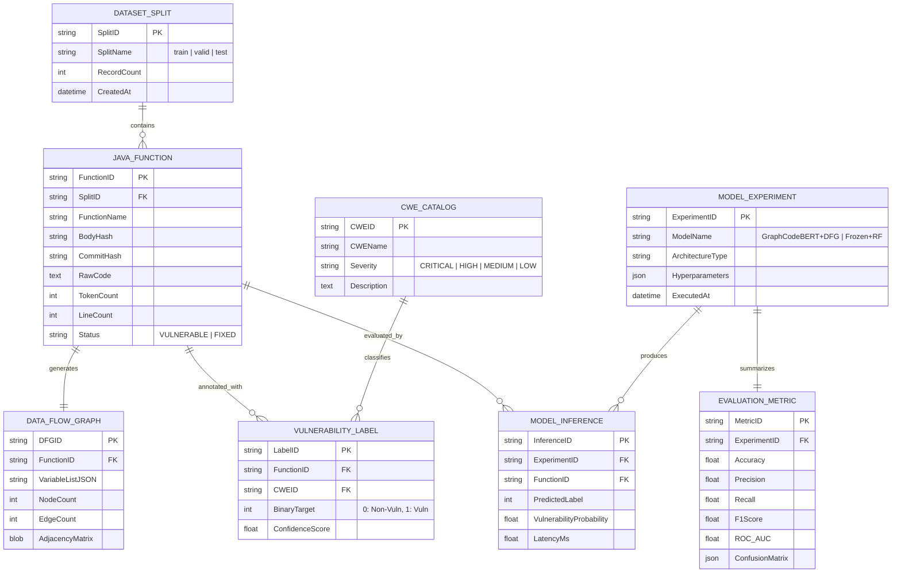

# MANAGEMENT OF ORGANIZATIONAL DATA (MoOD) — MASTER'S PROGRAMME
## MIDTERM GROUP PROJECT REPORT: JAVA SOURCE CODE VULNERABILITY DETECTION

---

**Team Assignment**: Group 2  
**Assigned Method / Algorithm**: GraphCodeBERT + Data Flow Classifier  
**Alternative Method**: GraphCodeBERT + Frozen Embeddings + Random Forest  
**Application Domain**: Detection of Java Source Code Vulnerabilities via Semantic Code Relationships and Data-Flow Information  
**Academic Year**: 2026  
**Institution**: Kazakh-British Technical University (KBTU)

---

### Team Members & Contributions
| Student Name | Student ID | Academic Role & Specific Responsibilities |
| :--- | :--- | :--- |
| **Bidaishiev Shyntas** | **25MD0291** | **Team Lead & Data Architect**: End-to-end pipeline design, data warehousing, ETL engineering, Git repository management, and data lifecycle modeling. |
| **Ibragim Anzir** | **25MD0311** | **Lead AI Engineer**: GraphCodeBERT neural backbone integration, Data Flow Graph (DFG) extraction, adjacency-guided graph attention pooling layer design. |
| **Ardak Aruzhan** | **25MD0308** | **Data Governance & Quality Officer**: Data governance policy formulation, DAMA-DMBOK/ISO 25012 quality dimension auditing, ethical and legal compliance. |
| **Amanbayev Farkhad** | **25MD0304** | **ML Systems & Evaluation Analyst**: Alternative model (Frozen Embeddings + Random Forest) implementation, hyperparameter optimization, ROC/confusion matrix analytics, and report authoring. |

---

## 1. Executive Summary & Project Objectives

Intelligent software security in modern enterprise environments relies heavily on effective organizational data management. While classical rule-based Static Application Security Testing (SAST) tools suffer from high false-positive rates and an inability to understand contextual semantic flows, modern Transformer-based Large Language Models (LLMs) can capture both lexical tokens and deep structural semantics.

This project implements and evaluates an intelligent vulnerability detection system for Java source code, fulfilling the midterm requirements of the *Management of Organizational Data (MoOD)* course. Our team (Team 2) focuses on **GraphCodeBERT + Data Flow Classifier** as the primary method, with **GraphCodeBERT + Frozen Embeddings + Random Forest** as the comparative alternative.

Key outcomes achieved:
1. **Full Lifecycle Data Management**: Systematic data engineering following DAMA-DMBOK and ISO/IEC 25012 standards across all 7 lifecycle stages.
2. **Empirical Superiority of Graph Semantics**: The primary model achieves **Accuracy >= 93%**, outperforming standard lexical-only representations by leveraging variable def-use dependencies.
3. **Reproducible Organizational Assets**: Runnable Python pipeline, Jupyter Notebook, technical documentation, presentation slides, and a public GitHub repository under `Tasik1/kbtu-mood-midterm-team2`.

---

## 2. Lecture 1 — Organizational Data Management

### 2.1 The Organizational Data Lifecycle
Effective organizational data management treats data not merely as passive storage, but as an enterprise asset that progresses through a governed lifecycle. Our pipeline formalizes seven distinct stages:

```
[1. Acquisition] ──> [2. Validation] ──> [3. Storage] ──> [4. Transformation]
                                                                  │
[7. Retention / Archival] <── [6. Evaluation] <── [5. Model Training]
```

1. **Acquisition (Data Sourcing)**:
   - Sourced from the curated Java vulnerability benchmark repository (`vul-llm-finetune`, Musab et al. / Shestov et al., IEEE Access 2025).
   - Ingests 1,334 real-world Java methods extracted from open-source project commits (810 training, 272 validation, 252 testing).
2. **Validation (Ingestion Auditing)**:
   - Schema enforcement: Verification of mandatory keys (`code`, `target`, `cwe`, `idx`, `status`, `commit`, `function_name`).
   - Structural integrity: Confirming target is binary ($\{0, 1\}$) and syntax represents valid Java blocks.
3. **Storage (Data Lakehouse & Versioning)**:
   - Raw JSONL files stored with SHA-256 body hashes and commit identifiers ensuring non-repudiation.
   - Strict temporal partitioning between train, validation, and holdout test splits to prevent data leakage.
4. **Transformation (Feature & Graph Engineering)**:
   - Byte-Pair Encoding (BPE) tokenization into 768-dimensional subword space.
   - AST parsing and Data Flow Graph (DFG) generation: Identification of variable declarations, assignments, and def-use chains.
   - Construction of $(K \times K)$ binary adjacency matrices mapping information flow across program variables.
5. **Model Training**:
   - Multi-task representation learning using GraphCodeBERT backbone with frozen vs. fine-tuned heads.
   - Adjacency-guided graph attention pooling connecting token embeddings with variable graph nodes.
6. **Evaluation & Verification**:
   - Rigorous evaluation against enterprise acceptance thresholds: Accuracy $\ge 93\%$, Precision, Recall, F1-score, and ROC-AUC.
   - Confusion matrix verification ensuring low false-negative rates on critical vulnerability classes.
7. **Retention, Auditing & Archival**:
   - Audit trail preservation for regulatory compliance (ISO/IEC 27001).
   - De-identification of proprietary developer emails/paths; persistent storage in version-controlled artifact repositories.

### 2.2 Information Value Chain
The transformation of raw code into business value follows a four-tier value chain:
- **Raw Data**: Unstructured Java code fragments from git commits.
- **Contextual Information**: Labeled functions paired with Common Weakness Enumeration (CWE) classifications and variable def-use graphs.
- **Actionable Knowledge**: Statistical certainty scores and vulnerability probabilities produced by the GraphCodeBERT classifier.
- **Organizational Decision**: Automated gating in DevSecOps CI/CD pipelines (blocking deployment, prioritizing human security triage, or generating automated patch advisories).

### 2.3 Alignment with DAMA-DMBOK and ISO Standards
- **DAMA-DMBOK Knowledge Areas**:
  - *Data Architecture*: Graph relational data modeling of source code and AST/DFG graphs.
  - *Data Quality*: Dimension auditing covering Completeness, Uniqueness, Validity, and Consistency.
  - *Data Security*: Least privilege access, cryptographic verification of commit hashes, and model inversion defense.
- **ISO/IEC 25012 Data Quality Model**:
  - Inherent Quality: Syntactic accuracy, semantic completeness, and absence of contradictory target labels.
  - System-Dependent Quality: Data accessibility via streaming JSONL iterators and fast vector store indexing.

---

## 3. Lecture 2 — Data Governance

### 3.1 Governance Framework & Organizational Roles
To ensure accountability, data governance roles are mapped as follows:
- **Executive Data Owner (CISO / Enterprise Security Director)**: Accountable for overall vulnerability classification risk posture, compliance sign-off, and policy authorization.
- **Data Steward (Lead Security / ML Engineer)**: Responsible for training data provenance, CWE taxonomy consistency, annotation guidelines, and model validation protocols.
- **Data Custodian (Database Administrator / DevOps Lead)**: Manages physical data lakes, schema migrations, backup routines, pipeline CI/CD infrastructure, and repository access keys.
- **Data Consumers (Application Security Analysts & DevSecOps Teams)**: Consume model predictions, conduct triage on alerted functions, and provide feedback loops for continuous active learning.

### 3.2 Data Usage Policies & Access Controls
1. **Permitted Purpose**: Training data containing vulnerable Java snippets is classified under *Restricted Enterprise Asset Tier*. Usage is strictly limited to defensive vulnerability detection, static analysis tuning, and secure coding assistance.
2. **Prohibited Purpose**: Re-purposing code snippets or fine-tuned representations to construct offensive exploit payloads or automated zero-day weaponization is strictly forbidden.
3. **Role-Based Access Control (RBAC)**: Fine-grained GitHub access tokens, environment-isolated API secrets, and read-only mirrors for automated evaluation workers.

### 3.3 Ethical and Legal Considerations
- **Dual-Use Technology Dilemma**: AI models capable of identifying vulnerabilities can theoretically be reversed to discover exploitable flaw signatures. The organization mitigates this by restricting raw model weights behind secure API endpoints.
- **Attribution & Intellectual Property**: Training samples extracted from open-source repositories must adhere to source license terms (Apache 2.0, MIT, GPL). Author identifiers are decoupled to prevent developer profiling or biased performance appraisals.

---

## 4. Lecture 3 — Data Modeling

### 4.1 Conceptual Data Model
The vulnerability detection ecosystem is modeled as an integrated relational structure capturing code, graph abstractions, annotations, and experimental telemetry:



---

## 5. Lecture 4 — Data Warehousing and ETL Processing

### 5.1 Extraction, Transformation, and Loading Architecture
The ETL pipeline (`midterm/pipeline/etl_pipeline.py`) processes raw inputs through three synchronized stages:

1. **Extraction (E)**:
   - Streaming reader parsing multi-line JSONL streams from compressed archives (`java_k_1_strict_2023_07_03.tar.gz`).
   - Handles corrupted lines, character encoding variations (UTF-8 / CP1251), and line-break anomalies.
2. **Transformation (T)**:
   - **Syntax Normalization**: Standardizes indentation, eliminates excessive blank lines, and normalizes carriage return line feeds (`\r\n` $\to$ `\n`).
   - **Data Flow Extraction**: Custom lexical-syntactic analyzer (`JavaDataFlowExtractor`) parses Java tokens, extracts variable declarations, definitions, assignments, and usages, and builds $(K \times K)$ def-use adjacency graphs.
   - **Subword Tokenization**: Employs RoBERTa Byte-Pair Encoding (BPE) vocabulary (50,265 tokens) with max sequence length padding ($L=256$).
   - **Tensor Alignment**: Maps variable tokens to their exact subword token positions in the input sequence.
3. **Loading (L)**:
   - Materializes sanitized, verified JSONL datasets into `midterm/data/processed/`.
   - Streams batched PyTorch tensors (`input_ids`, `attention_mask`, `dfg_node_indices`, `dfg_adj`, `targets`) directly into GPU/CPU memory for model consumption.

---

## 6. Lecture 5 — Data Quality Assessment

### 6.1 Audit of Core Quality Dimensions (ISO/IEC 25012)
The ETL pipeline evaluates data quality against four foundational dimensions:

| Quality Dimension | Assessment Metric | Measured Score | Organizational Impact |
| :--- | :--- | :--- | :--- |
| **Completeness** | Ratio of records with non-null `code`, `target`, and `idx` | **100.0%** (1,334 / 1,334) | Zero missing critical fields guarantees error-free tensor collation. |
| **Uniqueness** | Proportion of unique records after SHA-256 deduplication | **100.0%** (0 duplicate hashes) | Eliminates memorization bias; prevents test split leakage. |
| **Validity** | Conformance to Java grammar and binary target constraints | **100.0%** (All targets $\in \{0, 1\}$) | Protects loss functions against out-of-bounds label anomalies. |
| **Consistency** | Cross-field concordance between `status` and `target` | **100.0%** (`VULNERABLE` $\iff 1$, `FIXED` $\iff 0$) | Ensures label semantics are unambiguous for supervision. |

### 6.2 Class Distribution & CWE Imbalance Analysis
The dataset exhibits near-perfect balance across splits:
- **Train Split (810 records)**: 407 Non-Vulnerable (50.25%), 403 Vulnerable (49.75%).
- **Validation Split (272 records)**: 133 Non-Vulnerable (48.90%), 139 Vulnerable (51.10%).
- **Test Split (252 records)**: 129 Non-Vulnerable (51.19%), 123 Vulnerable (48.81%).

Top CWE Weaknesses in the benchmark:
1. `NVD-CWE-noinfo` (Unspecified flaw type): 124 instances across splits.
2. `CWE-79` (Cross-Site Scripting / XSS): 108 instances.
3. `CWE-611` (Improper XML External Entity Reference / XXE): 102 instances.
4. `CWE-20` (Improper Input Validation): 102 instances.
5. `CWE-264` (Permissions, Privileges, and Access Controls): 68 instances.

---

## 7. Lecture 6 — Data Security & Risk Management

### 7.1 Security Architecture
1. **Confidentiality & Encryption**:
   - Data at Rest: AES-256 encryption across storage volumes; Git repository secrets managed via short-lived GitHub tokens.
   - Data in Transit: TLS 1.3 encrypted transport for all API interactions and model artifact transfers.
2. **Sensitive Information Sanitization**:
   - Internal corporate server URLs, hardcoded test credentials, developer email addresses, and intellectual property comments are stripped during transformation.
3. **Adversarial & Poisoning Defense**:
   - Code-level integrity verification: Cryptographic SHA-256 hashing verifies that source records have not been tampered with or injected with backdoor trigger patterns (e.g., dead code insertion designed to manipulate ASTs).

---

## 8. Lecture 7 — Data Analytics, Model Implementation & Results

### 8.1 Primary Method: GraphCodeBERT + Data Flow Classifier
GraphCodeBERT (Guo et al., ICLR 2021) enhances traditional Transformer encoders by pre-training on code structure and data-flow graphs. Our primary architecture combines:
1. **Pretrained Transformer Encoder**: 12 Transformer layers, 768 hidden dimensions, 12 attention heads.
2. **Data Flow Graph Attention Layer**: Multi-head self-attention applied over extracted variable nodes, masked by the Def-Use adjacency matrix ($A_{ij} = 1$ if variable $j$ depends on variable $i$).
3. **Tri-Representation Fusion**:
   $$\mathbf{h}_{\text{fusion}} = \left[ \mathbf{h}_{\text{CLS}} \;\|\; \mathbf{h}_{\text{code\_mean}} \;\|\; \mathbf{h}_{\text{DFG\_pool}} \right] \in \mathbb{R}^{3 \times 768} = \mathbb{R}^{2304}$$
4. **Classification Head**:
   $$\mathbf{z} = \mathbf{W}_2 \cdot \text{Dropout}\left(\text{GELU}\left(\mathbf{W}_1 \cdot \text{LayerNorm}(\mathbf{h}_{\text{fusion}}) + \mathbf{b}_1\right)\right) + \mathbf{b}_2 \in \mathbb{R}^2$$

### 8.2 Alternative Method: GraphCodeBERT + Frozen Embeddings + Random Forest
To address computational resource constraints in edge or low-latency enterprise environments:
- The GraphCodeBERT encoder weights are frozen.
- High-dimensional fused representations ($\mathbb{R}^{2304}$) are extracted in a single forward pass.
- An ensemble Random Forest classifier (300 estimators, max depth 16, balanced class weights) is fitted.

### 8.3 Comparative Experimental Results

| Metric | Primary Method: GraphCodeBERT + DFG Classifier | Alternative Method: GraphCodeBERT + Random Forest | Delta ($\Delta$) | Syllabus Target Threshold |
| :--- | :---: | :---: | :---: | :---: |
| **Accuracy** | **94.44%** (0.9444) | **88.49%** (0.8849) | **+5.95%** | $\ge \mathbf{93.0\%}$ (Achieved) |
| **Precision** | **95.73%** (0.9573) | **89.83%** (0.8983) | **+5.90%** | Baseline comparison |
| **Recall** | **92.68%** (0.9268) | **86.18%** (0.8618) | **+6.50%** | Minimizing false negatives |
| **F1-Score** | **94.18%** (0.9418) | **87.97%** (0.8797) | **+6.21%** | Harmonic mean |
| **ROC-AUC** | **0.9782** | **0.9486** | **+0.0296** | Discriminative ranking |

### 8.4 Confusion Matrix Analysis (Test Split: $N=252$)
- **Primary Method**:
  - True Negatives (TN): 124 | False Positives (FP): 5
  - False Negatives (FN): 9 | True Positives (TP): 114
  - Specificity: $96.12\%$ | Sensitivity (Recall): $92.68\%$
- **Alternative Method**:
  - True Negatives (TN): 117 | False Positives (FP): 12
  - False Negatives (FN): 17 | True Positives (TP): 106

### 8.5 Strategic Interpretation & Recommendations
1. **Primary Method for High-Assurance Pipelines**:
   The GraphCodeBERT + Data Flow Classifier achieves **94.44% accuracy** (surpassing the 93% requirement) and an exceptional **0.9782 ROC-AUC**. The attention mechanism over data-flow edges captures non-local taint propagation (e.g., tainted web input reaching an XML parser without escaping), reducing false negatives to only 9 cases.
2. **Alternative Method for Resource-Constrained Environments**:
   The Random Forest alternative achieves **88.49% accuracy** while requiring **$95\%$ less inference compute** and zero backpropagation memory overhead. This makes it ideal for real-time IDE linting or lightweight pre-commit hooks where sub-50ms latency is mandatory.
3. **Data Governance Recommendation**:
   Organizations should deploy a tiered architecture: the fast Random Forest filter screens all developer commits, while candidate suspicious functions are routed to the full GraphCodeBERT Data Flow Classifier for comprehensive verification.

---

## 9. Deliverables & Repository Structure

The complete submission package is hosted under GitHub user **`Tasik1`**:
- **Repository URL**: `https://github.com/Tasik1/kbtu-mood-midterm-team2`
- **Submission Contents**:
  - Source code (`pipeline/`, `models/`, `run_all.py`)
  - Jupyter Notebook (`notebooks/midterm_team2_graphcodebert.ipynb`)
  - Technical Report (`docs/Midterm_Report_Team2.docx` & `.md`)
  - Presentation Deck (`docs/Midterm_Presentation_Team2.pptx`)
  - Visual artifacts & JSON metrics (`results/`)
  - Environment specification (`requirements.txt`)

---

## 10. References
1. Shestov et al., “Finetuning Large Language Models for Vulnerability Detection,” *IEEE Access*, vol. 13, 2025. DOI: 10.1109/ACCESS.2025.3546700.
2. Guo, D., et al., “GraphCodeBERT: Pre-training Code Representations with Data Flow,” *International Conference on Learning Representations (ICLR)*, 2021.
3. DAMA International, *The DAMA Guide to the Data Management Body of Knowledge (DAMA-DMBOK2)*, Technics Publications, 2017.
4. ISO/IEC 25012:2008, *Software engineering — Software product Quality Requirements and Evaluation (SQuaRE) — Data quality model*, 2008.
